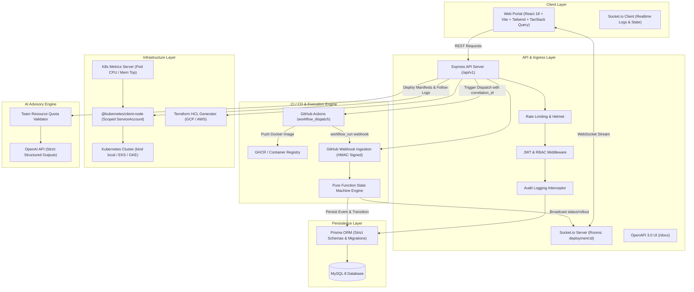

# Internal Developer Platform (IDP)

[](https://github.com/systemwithayush/IDP/actions)
[](LICENSE)
[](https://nodejs.org)
[](https://www.typescriptlang.org/)
[](apps/api)
[](http://localhost:3000/docs)

A self-service internal developer portal where engineering teams register services, scaffold new microservices via Golden Path templates, configure environments and AES-256-GCM encrypted secrets, execute Kubernetes rollouts via GitHub Actions, stream live pod logs, receive metrics-grounded AI infrastructure right-sizing recommendations, and export production-ready multi-file Terraform HCL.

---

## 🏛️ System Architecture



---

## ⚡ Quick Start (< 5 Minutes)

```bash
# 1. Clone repository
git clone https://github.com/systemwithayush/IDP.git
cd IDP

# 2. Setup environment
cp .env.example .env

# 3. Start database
docker compose -f infra/docker-compose.yml up -d

# 4. Optional: Start Kind Kubernetes cluster with metrics-server & ingress
# On Linux / Mac:
bash infra/kind-up.sh
# On Windows:
infra\kind-up.bat

# 5. Install dependencies
npm install

# 6. Database setup & seed
npm run db:generate
npm run db:migrate
npm run db:seed

# 7. Run full test suite (155 tests, >85% coverage)
npm test

# 8. Start development servers
npm run dev
```

Visit:
- **Frontend Portal**: [http://localhost:5173](http://localhost:5173)
- **API Server & Health**: [http://localhost:3000/ready](http://localhost:3000/ready)
- **Interactive Swagger OpenAPI Documentation**: [http://localhost:3000/docs](http://localhost:3000/docs)
- **5-Minute End-to-End Walkthrough Script**: [docs/DEMO.md](docs/DEMO.md)

---

## 🚀 Key Platform Capabilities

1. **Self-Service Golden Paths**:
   Instant scaffolding of Node.js Express, Python FastAPI, and React Static apps with Dockerfiles, typed Kubernetes manifests, GitHub Actions workflows, and Terraform infrastructure.
2. **Deterministic Deployment State Machine**:
   Pure-function state engine tracking `requested` -> `building` -> `pushed` -> `applying` -> `rolling_out` -> `succeeded` with automated detection of CrashLoopBackOff and 1-click rollback.
3. **Zero-Secret Policy & Envelope Encryption**:
   AES-256-GCM encryption for all sensitive variables at rest, masking values in transit with lead/admin reveal auditing.
4. **Grounded AI Infrastructure Rightsizing**:
   Analyzes 7-day P95 Prometheus metrics using OpenAI structured outputs with automatic schema retries, quota bounds enforcement, and interactive approval diffs.
5. **Multi-File Terraform HCL Generator**:
   Generates production-ready `versions.tf`, `variables.tf`, `main.tf`, `database.tf`, `storage.tf`, and `outputs.tf` for GCP and AWS workloads.
6. **Immutable Audit Trail**:
   Every mutation, secret reveal, and rollback is permanently recorded with user identity, timestamp, and JSON delta metadata.

---

## 📐 Documentation Index

- [Architecture Guide](docs/ARCHITECTURE.md)
- [Architecture Decision Records (ADRs 001 - 007)](docs/DECISIONS.md)
- [Entity-Relationship Diagram (13 Core Entities)](docs/er.md)
- [Step-by-Step Runbook](docs/STEPS_TO_RUN.md)
- [Interactive Demo Walkthrough](docs/DEMO.md)
