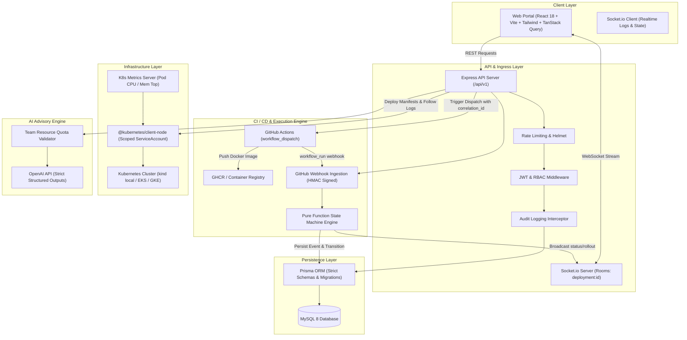

# Internal Developer Platform (IDP)

[](https://github.com/systemwithayush/IDP/actions)
[](LICENSE)
[](https://nodejs.org)
[](https://www.typescriptlang.org/)

A self-service internal developer portal where engineering teams register services, configure environments and encrypted secrets, execute Kubernetes rollouts via GitHub Actions, stream live pod logs, and receive metrics-grounded AI infrastructure right-sizing recommendations.

---

## 🏛️ System Architecture



---

## ⚡ Quick Start (< 5 Minutes)

```bash
# 1. Clone repository
git clone https://github.com/systemwithayush/IDP.git
cd IDP

# 2. Setup environment
cp .env.example .env

# 3. Start database
docker compose -f infra/docker-compose.yml up -d

# 4. Install dependencies
npm install

# 5. Database setup & seed
npm run db:generate
npm run db:migrate
npm run db:seed

# 6. Run test suite
npm test

# 7. Start dev environment
npm run dev
```

Visit:
- **Frontend Portal**: [http://localhost:5173](http://localhost:5173)
- **API Server**: [http://localhost:4000](http://localhost:4000)

Detailed instructions available in [docs/STEPS_TO_RUN.md](docs/STEPS_TO_RUN.md).

---

## 📐 Design Decisions & Tradeoffs

1. **CI Builds Container Images, Not the API Server**:
   Mounting `/var/run/docker.sock` to the API compromises container sandbox isolation and introduces serious host vulnerability. Decoupling image compilation to GitHub Actions provides isolated, auditable ephemeral runners and cryptographically tagged releases in GHCR.
2. **Direct Kubernetes Apply vs. GitOps**:
   The IDP uses `@kubernetes/client-node` with a dedicated namespace-scoped `ServiceAccount` for instantaneous rollout tracking, live log streaming, and sub-second automated rollbacks. An ArgoCD-compatible GitOps repository adapter is provided in the manifest generator.
3. **Advisory AI with Human Approval**:
   LLMs suggest resource optimization based on real `metrics-server` telemetry. To prevent runaway cost or capacity depletion, all suggestions are validated against team `resource_quotas` and require explicit Team Lead / Admin approval before updating manifests.

---

## 📊 Database Schema

See the comprehensive [Database ER Diagram](docs/er.md) for detailed relations across all 13 core entities.

